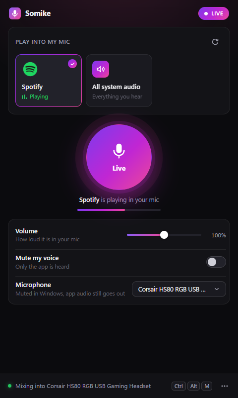

# Somike

[](https://github.com/Eric-MR/somike/actions/workflows/ci.yml)
[](https://github.com/Eric-MR/somike/releases)
[](LICENSE)


Route the audio of any Windows application into your **real, physical
microphone**, so Discord, games and other voice chats receive it as mic
input. No virtual audio device is created, and the microphone selection in
your other apps stays exactly as it is.

> [!WARNING]
> **Beta, not finished.** Somike is in public beta for testing and
> feedback. The full pipeline works end to end on real hardware
> (Windows 11 25H2, USB headset microphone; Spotify into Discord), but expect
> rough edges, and the binaries are not code-signed yet.
> See [Limitations](#limitations) and please
> [report what you find](https://github.com/Eric-MR/somike/issues/new/choose).

## How it works

```
 Source app (Spotify, browser, game...)
        |  WASAPI process loopback (per app, or everything)
        v
 somike.exe  --writes-->  %ProgramData%\Somike\ring-v1.bin  (shared ring)
                                         |
                                         v reads
 Physical mic --> audiodg.exe [ ... -> somike_apo.dll (capture effect) ] --> Discord, games, ...
```

1. **Capture**: `somike.exe` records the selected application's output with
   the WASAPI *process loopback* API (Windows build 20348+, i.e. Windows 11).
2. **Transport**: audio goes into a lock-free ring buffer in a shared
   memory-mapped file.
3. **Inject**: a small *Audio Processing Object* (APO), registered as the
   **endpoint effect** of your existing microphone, runs inside the Windows
   audio engine. It mixes the ring audio into the microphone signal before
   Windows hands it to the apps, so every app that records from the mic
   receives the mix, including apps that record in *raw* mode such as Discord.

The full investigation, including why this works without a virtual device and
what the trade-offs are, is in [docs/feasibility.md](docs/feasibility.md).

## Quick start

Requirements: **Windows 11** (x64) and a microphone. Windows 10 is not
supported (per-app capture needs build 20348+), nor are ARM64 PCs yet.

1. Download **`Somike-Setup-<version>.exe`** from the
   [latest release](https://github.com/Eric-MR/somike/releases) and run it.
   Keep **Connect Somike to my default microphone** checked: one Windows
   prompt, and sound pauses for a second. The setup program is not
   code-signed yet, so SmartScreen may warn ("More info → Run anyway"); with
   *Smart App Control* on, Windows blocks it (see [Limitations](#limitations)).
2. Click the app you want to hear in your mic. Apps that are playing show up
   automatically with their icon; *All system audio* is always there.
3. Press **Go live** (or **Ctrl+Alt+M** anywhere, e.g. in a game).

For another microphone, pick it at the bottom of the window and click
**Set up** once.

It is plug and play: if the chosen app is not running yet, Somike shows
*Waiting* and connects the moment it starts; if the app or Windows Audio
restarts, it reconnects by itself. Volume, "mute my voice" and the microphone
are on the same screen; your choices are remembered.



To update, run the new setup program (it keeps your settings). To uninstall,
use *Settings → Apps → Installed apps → Somike*; this also restores every
microphone exactly as it was. **Remove Somike from this microphone** in the
**⋯** menu does that for one microphone only.

The command-line tools in `C:\Program Files\Somike` cover the same and more:

```powershell
somike-apoctl list                      # microphones + injector state
somike-apoctl status                    # detailed diagnostics (live APO heartbeat)
somike-apoctl install --dry-run         # show exactly what would change
somike-apoctl install --restart-audio   # elevated
somike-apoctl uninstall --all --restart-audio
somike-selftest --modes                 # end-to-end check on the default mic (plays a test tone)
```

## Soundboard

The **Soundboard** tab plays short sounds straight into your microphone, with
a click or a global hotkey, whether or not an app is live at the same time.

- **Your own files**: **Add files** or drag & drop MP3, WAV, FLAC, M4A/AAC,
  WMA (Ogg/Opus with the free *Web Media Extensions* from the Microsoft
  Store). Files are copied into `%LOCALAPPDATA%\Somike\Soundboard`, so the
  board keeps working when the originals move. Up to 5 minutes per sound.
- **Free sound effects**: **Get sounds** searches thousands of short effects
  on [Freesound](https://freesound.org) and
  [Wikimedia Commons](https://commons.wikimedia.org) through
  [Openverse](https://openverse.org). Only public-domain (CC0) sounds are
  offered, so they are free to use in any voice chat without giving credit.
  ▶ lets you listen first (only you hear it); the credit of every downloaded
  sound is kept and shown.
- **Hotkeys**: every sound can get one (e.g. *Num 1*, *F13*, *Ctrl+Alt+1*),
  plus one to stop all sounds. They work in every app, also in games.
- **Hear them myself**: sounds also play on your speakers/headphones, with
  their own volume, separate from how loud they are in the mic.
- Click a playing sound to stop it; edit name, icon, colour, volume and hotkey
  with **⋯** (or a right-click).

## Building from source

Visual Studio 2022/2026 or the Build Tools with the C++ workload, CMake 3.25+
and Ninja:

```powershell
./scripts/build.ps1 -Preset release        # builds + runs unit tests
./scripts/build-installer.ps1              # Somike-Setup-<version>.exe (needs Inno Setup 6)
```

The binaries end up in `build/release/bin`, the setup program in
`build/installer`. Details, debugging the APO, the UI and smoke tests and the
release process: [docs/building.md](docs/building.md).

## Repository layout

| Path | What |
|------|------|
| `src/protocol` | Header-only shared-memory layout and APO identity (single source of truth) |
| `src/dsp` | Portable, unit-tested core: ring writer/reader, resampler, mixer, `Injector` |
| `src/common` | Small Win32 helpers (handles, registry, mapping, logging) |
| `src/installer` | Endpoint inspection, install planning, elevated system changes with backup |
| `src/core` | App engine: device/session discovery, loopback capture, router, settings |
| `src/apo` | `somike_apo.dll`, the capture APO (thin COM shell around `dsp::Injector`) |
| `src/apoctl` | `somike-apoctl.exe`, CLI installer and diagnostics |
| `src/app` | `somike.exe`: Win32 window + WebView2 hosting the HTML UI in `src/app/ui` |
| `tools` | `somike-selftest` (hardware check), `ui-dev` (UI preview server, app driver, icon) |
| `tests` | GoogleTest unit tests |
| `docs` | Feasibility study, architecture, IPC spec, build guide, ADRs |
| `.github` | CI and release workflows, issue and pull-request templates |

## Documentation

- [Feasibility study](docs/feasibility.md): the technical investigation and alternatives
- [Architecture](docs/architecture.md): components, threading, failure model, roadmap
- [IPC protocol](docs/ipc-protocol.md): the shared ring buffer specification
- [Building & debugging](docs/building.md)
- [Architecture decision records](docs/adr)
- [Changelog](CHANGELOG.md)

## Contributing and feedback

Bug reports, [compatibility reports](https://github.com/Eric-MR/somike/issues/new?template=compatibility.yml)
(which microphones and apps work) and pull requests are welcome; see
[CONTRIBUTING.md](CONTRIBUTING.md) and the [code of conduct](CODE_OF_CONDUCT.md).
Please report security problems privately as described in
[SECURITY.md](SECURITY.md).

## Limitations

- **Admin once**: registering an effect on a microphone needs administrator
  rights and an audio-service restart. Routing itself runs unelevated.
- **Code signing**: with *Smart App Control* or WDAC enforcing, Windows blocks
  unsigned binaries, including the APO inside `audiodg.exe`. Release builds
  must be signed.
- **Windows 11 only**: per-app capture (process loopback) needs build 20348+,
  which Windows 10 never got. **ARM64** Windows runs a native ARM64 audio
  engine that cannot load the x64 APO; the setup program refuses both.
- **Exclusive-mode streams** bypass all effects, so apps that open the mic
  that way (rare for voice apps) don't get the routed audio. Raw-mode capture,
  which Discord uses, is covered.
- **Upgrading from 0.1.0** (pre-release builds only): that version registered
  as a stream effect, which raw-mode apps skip. The app shows **Update**; one
  click (and the Windows prompt) moves it.
- **Driver updates** may reset the microphone's effect configuration; the app
  detects this and offers **Repair**.
- Apps' own noise suppression (Discord, Teams...) may filter music; turn it
  down for best results.
- Choosing *All system audio* while in a voice chat feeds the other
  participants' voices back to them; prefer routing a single app.

## License

[MIT](LICENSE)
